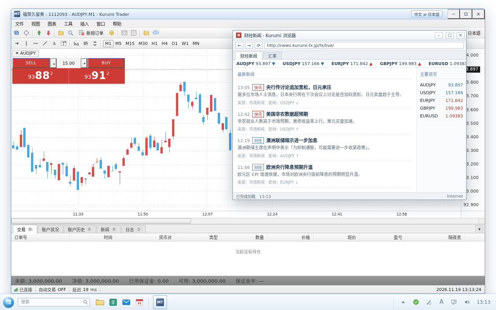

# fx-MT4｜久留美的模拟交易桌面

一个可以点、可以下模拟单的日系交易桌面。浏览器打开即用，无需安装 MT4、注册账户或联网。**行情、新闻、账户和盈亏都是模拟数据，不连接券商，不构成投资建议。**

## 为什么做这个桌面？

《FX戦士くるみちゃん》的故事从 2008 年秋天开始：福贺久留美的母亲在外汇交易中损失了 2,000 万日元，随后自杀。到了 2014 年，读大学的久留美也开始交易，想把母亲亏掉的钱赚回来。[KADOKAWA 漫画第一卷介绍](https://www.kadokawa.co.jp/topics/6121/)

本项目复刻的是动画里的电脑操作场景，而不是漫画阅读器或真正的 MetaTrader 4。打开澳元兑日元的分钟图，留意报价末位的跳动，再看新闻弹窗出现时蜡烛线怎样变化——这是体验这个桌面的一个好起点。

## 第一次使用

1. 在仓库首页点 **Code → Download ZIP**，完整解压。双击 `fx-MT4.html`，用桌面版 Chrome 或 Edge 打开。不要在 GitHub 的源码预览页运行。
2. 在「口座を選択」窗口选一个演示账户并点 **OK**，无需输入个人信息。点 **日本語 ⇄ 中文** 切换界面。
3. 在图表工具栏切换 M1 / M5 等周期。点击「新規注文／新订单」查看下单窗口，或用图上 BUY / SELL 发出模拟订单；在终端的交易与历史页查看结果。
4. 打开开始菜单中的财经新闻，观察模拟消息与货币对走势的联动。交易窗口被最小化时，可点任务栏按钮恢复。

## 修改与验证

`mt4.tpl.html` 管布局和样式；`mt4.js` 管行情、图表、订单、桌面窗口和翻译。在项目目录运行 `python build.py` 重新生成单文件，再刷新浏览器。直接编辑生成的 HTML 会在下次构建时被覆盖。

可选窗口回归测试：安装 Python 及 Playwright 后，依次执行 `python -m pip install playwright`、`python -m playwright install chromium`、`python test_wm.py`。日常使用不需要这些工具。

## 授权与边界

本项目为非官方同人界面，与原作权利人、MetaQuotes 或券商无关联。仓库原创代码采用 MIT 许可证；不授予对原作角色、名称、商标或第三方素材的权利。发行包不含漫画页面、动画参考截图或原工作目录中的壁纸。
